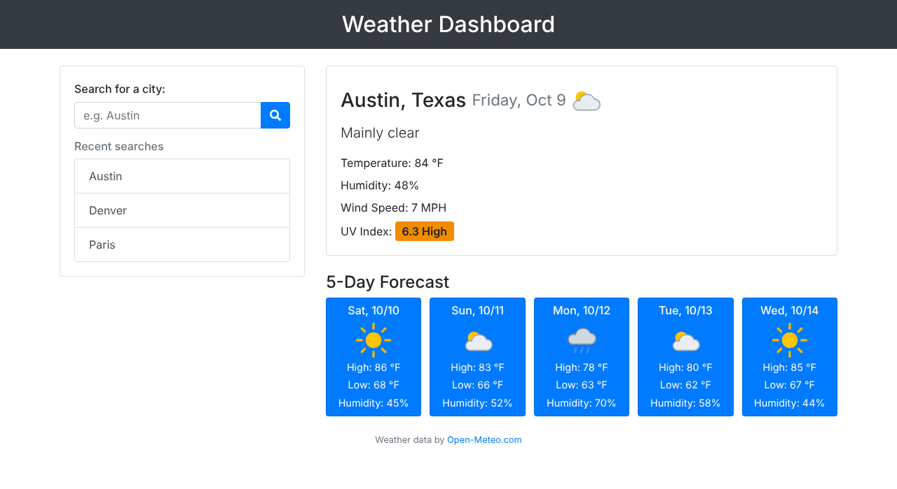

<h1 align="center">🌤️ Weather Dashboard</h1>

<p align="center">Search any city for current conditions and a 5-day forecast. Your recent searches stay one click away.</p>

<p align="center">
  
  
  
  
  
</p>

<p align="center"><a href="https://christiankrantz11.github.io/weather-dashboard/"><strong>🚀 Live Demo</strong></a></p>

<p align="center"></p>

<p align="center"><sub>Screenshot taken with sample weather data.</sub></p>

## Features

- Search for any city by name. Results show the city with its state or country (for example, "Austin, Texas").
- Current conditions:
  - Weather description and icon
  - Temperature (°F)
  - Humidity
  - Wind speed (mph)
  - UV index
- UV index badge color-coded with the WHO scale:

  | UV index | Category |
  | --- | --- |
  | 0–2 | Low |
  | 3–5 | Moderate |
  | 6–7 | High |
  | 8–10 | Very high |
  | 11+ | Extreme |

- 5-day forecast cards with the date, an icon, the high and low temperature, and humidity
- Your 5 most recent searches are saved in `localStorage`. Click one to load it again.
- Reopens your last searched city when you come back
- Friendly messages for loading states and cities that can't be found
- Responsive layout for desktop and mobile

## Built With

- HTML, CSS and JavaScript (`fetch`, no jQuery)
- [Bootstrap 4](https://getbootstrap.com/docs/4.3/)
- [Font Awesome](https://fontawesome.com/)
- [Open-Meteo](https://open-meteo.com/):
  - [Geocoding API](https://open-meteo.com/en/docs/geocoding-api) turns city names into coordinates
  - [Forecast API](https://open-meteo.com/en/docs) supplies current conditions and the daily forecast
  - Both are free and need no API key

## Running Locally

No build step and no API key are needed.

1. Clone the repo:
   ```bash
   git clone https://github.com/ChristianKrantz11/weather-dashboard.git
   ```
2. Open `index.html` in your browser.

## How It Works

1. The city name is sent to Open-Meteo's geocoding API to find its latitude and longitude.
2. The coordinates are sent to the forecast API. It returns the current conditions and 6 days of daily data in °F and mph, using the city's local time zone.
3. The page builds the current-weather card and the 5 forecast cards (tomorrow onward). Text is inserted with `textContent`, so search input can't inject HTML.

## User Story

<details>
<summary>Original assignment user story</summary>

```
AS A traveler
I WANT to see the weather outlook for multiple cities
SO THAT I can plan a trip accordingly
```

</details>

## Author

[ChristianKrantz11](https://github.com/ChristianKrantz11)
